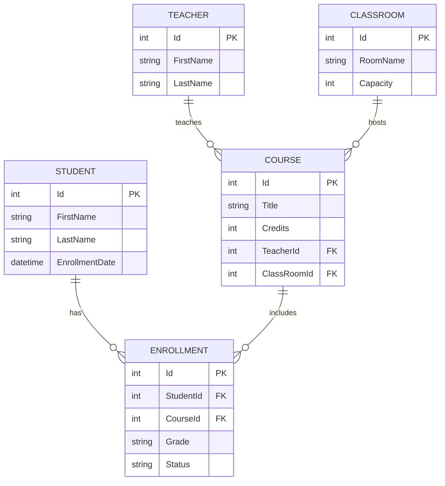

# UniManager

A .NET 10 REST API for managing university students, courses, teachers, classrooms, and enrollments.

[](https://github.com/docsi01/UniManager/actions/workflows/ci.yml)


## Features

- **Layered architecture:** API, business logic, repository, and models are separate projects, so each layer can be tested and changed on its own.
- **Generic EF Core repository** with SQL Server and versioned migrations.
- **Full CRUD** for students, teachers, courses, classrooms, and enrollments.
- **Strict request validation:** length limits, credit ranges, date rules, and checks that referenced IDs exist.
- **Consistent HTTP semantics:** `201 Created` with a `Location` header, `400` for invalid input, `404` for missing resources, and `409` for duplicate enrollments.
- **Interactive API docs** via Swagger UI.
- **Automated quality checks:** NUnit tests and a GitHub Actions pipeline that builds and tests on every push and pull request.

## Roadmap

- [ ] Enforce classroom capacity on enrollment, with a waitlist
- [ ] Course scheduling with conflict detection for rooms, teachers, and overlapping student classes
- [ ] Course prerequisites
- [ ] Replace string `grade` and `status` with a numeric grade and a status enum, plus GPA calculation
- [ ] Handle concurrent enrollments safely (optimistic concurrency) with a test that proves it
- [ ] JWT authentication with Admin, Teacher, and Student roles
- [ ] Pagination, filtering, and sorting on list endpoints
- [ ] Global error handling with `ProblemDetails` responses
- [ ] Integration tests with `WebApplicationFactory` and Testcontainers
- [ ] Dockerfile and `docker-compose.yml`, then a live deployment

## Projects

- **UniManagerApi** — ASP.NET Core API and dependency-injection setup
- **UniManager.Logic** — application and enrollment logic
- **UniManager.Repository** — generic EF Core repository, `UniDbContext`, and database migrations
- **UniManager.Models** — domain entities and request DTOs
- **UniManager.Tests** — NUnit unit tests for the student controller and logic

## Entity relationship diagram



## Requirements

- .NET 10 SDK
- SQL Server or SQL Server LocalDB
- The `dotnet-ef` tool for applying migrations (`dotnet tool install --global dotnet-ef`, if not already installed)

## Configure and run

Clone the repository and move into its directory:

```powershell
git clone https://github.com/docsi01/UniManager.git
cd UniManager
```

The API reads its SQL Server connection string from `ConnectionStrings:DefaultConnection`. Configure it using user secrets, environment variables, or local configuration; do not commit credentials.

For example, in PowerShell, set an environment variable for a local LocalDB instance:

```powershell
$env:ConnectionStrings__DefaultConnection = 'Server=(localdb)\MSSQLLocalDB;Database=UniManagerDb;Trusted_Connection=True;TrustServerCertificate=True;'
```

From the solution directory, apply the EF Core migrations and start the API:

```powershell
dotnet ef database update --project UniManager.Repository --startup-project UniManagerApi
dotnet run --project UniManagerApi
```

The HTTP launch profile uses `http://localhost:5234`; the HTTPS profile uses `https://localhost:7191`. In Development, Swagger UI is available at `/swagger` (for example, `http://localhost:5234/swagger`).

Run the test suite from the solution directory with:

```powershell
dotnet test UniManager.slnx --configuration Release
```

GitHub Actions runs a Release build and the tests on every push and pull request.

## API endpoints

The API uses `api/[controller]` routes. Controller names determine route segments, so the teachers route is `/api/Teachers`.

| Resource | Method | Route | Notes |
|---|---|---|---|
| Students | GET | `/api/Student/all` | List students |
| Students | GET | `/api/Student/{id}` | Get a student |
| Students | POST | `/api/Student` | Create a student |
| Students | PUT | `/api/Student/{id}` | Update a student |
| Students | DELETE | `/api/Student/{id}` | Delete a student |
| Courses | GET | `/api/Course/all` | List courses |
| Courses | GET | `/api/Course/{id}` | Get a course |
| Courses | POST | `/api/Course` | Create a course |
| Courses | PUT | `/api/Course/{id}` | Update a course |
| Courses | DELETE | `/api/Course/{id}` | Delete a course |
| Teachers | GET | `/api/Teachers/all` | List teachers |
| Teachers | GET | `/api/Teachers/{id}` | Get a teacher |
| Teachers | POST | `/api/Teachers` | Create a teacher |
| Teachers | PUT | `/api/Teachers/{id}` | Update a teacher |
| Teachers | DELETE | `/api/Teachers/{id}` | Delete a teacher |
| Classrooms | GET | `/api/ClassRoom/all` | List classrooms |
| Classrooms | GET | `/api/ClassRoom/{id}` | Get a classroom |
| Classrooms | POST | `/api/ClassRoom` | Create a classroom |
| Classrooms | PUT | `/api/ClassRoom/{id}` | Update a classroom |
| Classrooms | DELETE | `/api/ClassRoom/{id}` | Delete a classroom |
| Enrollments | GET | `/api/Enrollment/all` | List enrollments |
| Enrollments | GET | `/api/Enrollment/{id}` | Get an enrollment |
| Enrollments | POST | `/api/Enrollment` | Enroll a student in a course |
| Enrollments | PUT | `/api/Enrollment/{id}` | Update an enrollment |
| Enrollments | DELETE | `/api/Enrollment/{id}` | Delete an enrollment |

### Request validation and responses

- Student and teacher names are required, nonblank, and limited to 100 characters. Course titles are required, nonblank, and limited to 200 characters; classroom names are required, nonblank, and limited to 100 characters.
- Student `enrollmentDate` is required and must be today or earlier. It is supplied by the client; the API does not replace it with the current time.
- Course credits must be between 1 and 6. Classroom capacity and all supplied IDs must be positive. Course teacher/classroom IDs and enrollment student/course IDs must refer to existing records.
- Enrollment requests require nonblank `grade` and `status` values of at most 50 characters. The values supplied during creation are saved.
- Invalid request data returns **400 Bad Request**. A referenced or requested resource that does not exist returns **404 Not Found**. Successful creates return **201 Created** with the created resource and a `Location` header. Duplicate enrollments return **409 Conflict**.

### Example requests

Create a student (the enrollment date must be today or earlier), then list students:

```powershell
curl.exe -X POST http://localhost:5234/api/Student -H "Content-Type: application/json" -d '{"firstName":"Ada","lastName":"Lovelace","enrollmentDate":"2000-01-01"}'
curl.exe http://localhost:5234/api/Student/all
```

Create a student (the enrollment date must be today or earlier):

```json
{
  "firstName": "Ada",
  "lastName": "Lovelace",
  "enrollmentDate": "2000-01-01"
}
```

Create a classroom:

```json
{
  "roomName": "Science 101",
  "capacity": 30
}
```

Create a course:

```json
{
  "title": "Introduction to Computing",
  "credits": 3,
  "teacherId": 1,
  "classRoomId": 1
}
```

Enroll an existing student in an existing course with the requested grade and status:

```json
{
  "studentId": 1,
  "courseId": 1,
  "grade": "Not Graded",
  "status": "Enrolled"
}
```

## Database migrations

Migrations are in `UniManager.Repository/Migrations`. To create a migration after changing the EF Core model:

```powershell
dotnet ef migrations add MigrationName --project UniManager.Repository --startup-project UniManagerApi
```

Apply pending migrations with `dotnet ef database update` as shown above. Ensure the API and migration commands use the same `ConnectionStrings:DefaultConnection` value and database.
